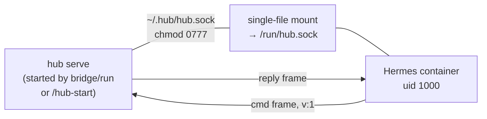

# Hermes bridge

## Run it (start here)

**1. `bridge/run` is the manager — it starts the hub itself.** No omp session
is required to host the socket:

```sh
bridge/run
```

Before launching the container it probes the hub with `hub ping` (a full
handshake + cmd/reply round-trip is liveness — docs/03 §Exit codes: exit 2 =
unavailable-hub):

- exit 0 — a hub is already serving on `~/.hub/hub.sock`; reuse it.
- exit 2 — no hub: starts a standalone one, `hub serve`, waits for the socket
  to accept, then continues. On exit it sends SIGTERM to that serve process —
  serve stops the socket and exits 0 — but only the hub this run started; a
  hub that was already up is left alone.

The standalone hub has no brain child and no widget (the socket, stores, and
ops need no omp session — `extensions/serve.ts` composes `createHubLocal`
with `serveBrain: false`).

**2. The omp-embedded hub (`/hub-start`) remains the alternative.** A session
with the plugin loaded hosts the same socket plus a brain child and the
widget. `bridge/run` reuses either — the wire is identical.

**3. Work the hub from inside Hermes.** Just ask:

> Use the hub tool: list the sessions, then answer session abc123 with "on it".

Everything the watcher agent can do, Hermes can now do — same `hub.sock` ops.

## What Hermes gets

Two injection points, registered by `bridge/hermes-hub-plugin/`:

- **`hub` tool** — one-shot op per call: `list`, `attention`, `answer`,
  `assign`, `send`, `tool`, `spawn`, `kill`, `archive`, `logTail`,
  `summaries`, `agent`. Reply is the hub's JSON frame verbatim.
- **`pre_llm_call` hook** — every turn injects a `<hub-status>` digest:
  open attention items + first three sessions, so Hermes knows the board
  state without being asked.

## How the transport works



- **Wire protocol** — newline-delimited JSON frames, one object per `\n`,
  every frame carries `v: 1`; owned by `docs/02-data-contracts.md §hub.sock`.
  The plugin speaks it directly (`bridge/hermes-hub-plugin/__init__.py`).
- **Single-file mount, not a directory** — Apple containers reject dir mounts
  over this path with `ENOTSUP`; a single-file virtiofs mount is the transport
  that works. TCP would be loopback-only and defeats the point.
- **Restart-proof** — the plugin reconnects every 2 s; a hub restart creates a
  new socket inode and the next poll finds it. No persistent connection.

## Files

| file | owns |
|---|---|
| `bridge/run` | the manager: ensures a live hub (reuse or `hub serve`), builds the image, `container run --rm -it`, socket + plugin mounts, `HUB_SOCKET` env |
| `extensions/serve.ts` + `cli/src/cmd_serve.ts` | the standalone hub: `hub serve` composition (`createHubLocal`, `serveBrain: false`), runs until SIGINT/SIGTERM, exit 0 |
| `bridge/Dockerfile` | `python:3.13-slim` + pinned `hermes-agent==0.19.0` wheel (Renovate bumps it), non-root `hermes` user |
| `bridge/hermes-hub-plugin/` | plugin: `__init__.py` (tool + hook + frame codec), `plugin.yaml` (discovery manifest) |

## Limits (v1)

- **No push** — hub → Hermes delivery without an agent turn is out of scope;
  the plugin API has no inbound socket. Hermes polls per turn. Revisit if
  Hermes adds a listener API.
- **`stream` is not a tool op** — the tool rejects it explicitly.
- **Standalone serve is ops-complete, agent-ops fail clean** — `agent`
  (toggle the hub agent child) returns `unavailable-hub` when no omp runtime
  backs the serve process.
- Per-op deadline 30 s (`docs/02 §hub.sock`); a timeout maps to a retryable
  `unavailable-hub` error, nothing throws past the plugin boundary.
