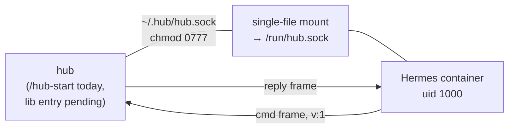

# Hermes bridge

## Run it (start here)

**1. Start the hub** so `~/.hub/hub.sock` exists. The hub is plain lib code
(`startUnixSocketServer`, `lib/adapters/unix_socket.ts`) — no omp needed, but
there is no standalone CLI entry for it yet, so the practical path is:

```sh
/hub-start
```

in any omp session with the plugin loaded. That session becomes the hub and
serves the socket (`chmod 0777` after listen so the container's uid 1000 can
connect).

**2. Run Hermes** — it's a CLI agent, one container per session, not a daemon:

```sh
bridge/run
```

Builds the image on first run (base image pull needs disk headroom) and starts
an interactive Hermes session with `--rm -it`. The socket file must already
exist (step 1) or the mount fails at start.

**3. Work the hub from inside Hermes.** Just ask:

> Use the hub tool: list the sessions, then answer session abc123 with "on it".

Everything the watcher agent can do, Hermes can now do — same `hub.sock` ops.

## What Hermes gets

Two injection points, registered by `bridge/hermes-hub-plugin/`:

- **`hub` tool** — one-shot op per call: `list`, `attention`, `answer`,
  `assign`, `send`, `tool`, `spawn`, `kill`, `archive`, `logTail`,
  `summaries`, `agent`. Reply is the hub's JSON frame verbatim.
- **`pre_llm_call` hook** — every turn injects a `<hub-status>` digest:
  open attention items + first three sessions, so Hermes knows the board
  state without being asked.

## How the transport works



- **Wire protocol** — newline-delimited JSON frames, one object per `\n`,
  every frame carries `v: 1`; owned by `docs/02-data-contracts.md §hub.sock`.
  The plugin speaks it directly (`bridge/hermes-hub-plugin/__init__.py`).
- **Single-file mount, not a directory** — Apple containers reject dir mounts
  over this path with `ENOTSUP`; a single-file virtiofs mount is the transport
  that works. TCP would be loopback-only and defeats the point.
- **Restart-proof** — the plugin reconnects every 2 s; a hub restart creates a
  new socket inode and the next poll finds it. No persistent connection.

## Files

| file | owns |
|---|---|
| `bridge/run` | one-shot start: builds the image, `container run --rm -it`, socket + plugin mounts, `HUB_SOCKET` env |
| `bridge/Dockerfile` | `python:3.13-slim` + pinned `hermes-agent==0.19.0` wheel (Renovate bumps it), non-root `hermes` user |
| `bridge/hermes-hub-plugin/` | plugin: `__init__.py` (tool + hook + frame codec), `plugin.yaml` (discovery manifest) |

## Limits (v1)

- **No push** — hub → Hermes delivery without an agent turn is out of scope;
  the plugin API has no inbound socket. Hermes polls per turn. Revisit if
  Hermes adds a listener API.
- **`stream` is not a tool op** — the tool rejects it explicitly.
- Per-op deadline 30 s (`docs/02 §hub.sock`); a timeout maps to a retryable
  `unavailable-hub` error, nothing throws past the plugin boundary.
