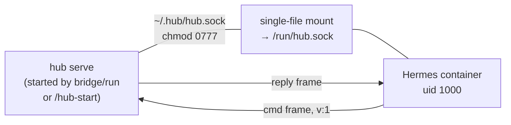

# Hermes bridge

## Run it (start here)

`bridge/run` is the manager — it starts the hub itself. No omp session
is required to host the socket:

```sh
bridge/run                  # interactive: drop into the hermes TUI
bridge/run "check the board" # batch: one agent turn, result printed
```

Interactive mode attaches your terminal to the container TTY and hands
you the hermes prompt (`❯`); the plugin injects hub status each turn.
Batch mode runs one turn (`hermes -z`) with the given prompt, prints the
result, and exits. Both reuse a live hub (probe via `hub ping`) or start
a standalone one (`hub serve`); on exit the script stops only a hub it
started itself.

Before launching the container it probes the hub with `hub ping` (a full
handshake + cmd/reply round-trip is liveness — docs/03 §Exit codes: exit 2 =
unavailable-hub):

- exit 0 — a hub is already serving on `~/.hub/hub.sock`; reuse it.
- exit 2 — no hub: starts a standalone one, `hub serve`, waits for the socket
  to accept, then continues. On exit it sends SIGTERM to that serve process —
  serve stops the socket and exits 0 — but only the hub this run started; a
  hub that was already up is left alone.

The standalone hub has no brain child and no widget (the socket, stores, and
ops need no omp session — `extensions/serve.ts` composes `createHubLocal`
with `serveBrain: false`).

**State persists.** The container mounts a host directory at
`~/.hermes` (`HERMES_STATE_DIR`, default `~/.hermes-bridge`) —
config.yaml, auth.json, .env, checkpoints survive `--rm`. The hub plugin
itself is bind-mounted from `bridge/hermes-hub-plugin/` at run time, so
plugin edits never need a rebuild; only a Dockerfile change does.

**2. The omp-embedded hub (`/hub-start`) remains the alternative.** A session
with the plugin loaded hosts the same socket plus a brain child and the
widget. `bridge/run` reuses either — the wire is identical.

**3. Work the hub from inside Hermes.** Just ask:

> Use the hub tool: list the sessions, then answer session abc123 with "on it".

Everything the watcher agent can do, Hermes can now do — same `hub.sock` ops.

## What Hermes gets

Two injection points, registered by `bridge/hermes-hub-plugin/`:

- **`hub` tool** — one-shot op per call: `list`, `attention`, `answer`,
  `assign`, `send`, `spawn`, `kill`, `archive`, `agent`, `sessions`, `ping`
  (`tool`/`logTail`/`summaries` are CLI-only today — the plugin hub denies
  them). Reply is the hub's JSON frame verbatim; the tool description names
  each op's args, so "list my omp sessions" is a one-call ask.
- **`pre_llm_call` hook** — every turn injects a `<hub-status>` digest:
  open attention items + first three omp sessions (kind, phase, description,
  cwd), pulled from a single `list` round-trip, so Hermes knows the board
  state — and the word "omp" — without being asked.

## How the transport works



- **Wire protocol** — newline-delimited JSON frames, one object per `\n`,
  every frame carries `v: 1`; owned by `docs/02-data-contracts.md §hub.sock`.
  The plugin speaks it directly (`bridge/hermes-hub-plugin/__init__.py`).
- **Single-file mount, not a directory** — Apple containers reject dir mounts
  over this path with `ENOTSUP`; a single-file virtiofs mount is the transport
  that works. TCP would be loopback-only and defeats the point.
- **Restart-proof** — every client (tool calls and the push subscriber alike)
  reconnects until the hub is back; a hub restart creates a new socket inode
  and reconnects find it. Tool calls stay one-shot; only the push subscriber
  below holds a persistent connection.

## Push (hub → Hermes)

The reverse direction of the transport above, so the hub can reach Yuri on
WhatsApp the moment an omp session stops and needs him — without waiting for
a Hermes agent turn:

- **Subscriber** — a long-lived plugin thread (`hermes-hub-push`) opens a
  second socket connection, sends `hello` with `subscribe: true` (docs/02
  §hub.sock), and reads `event` frames. Frames that fail to parse are
  skipped, not fatal; disconnects retry with a 5 s backoff. The command
  channel stays one-shot — this is the only persistent connection.
- **What triggers a push** — committed attention items of the
  human-needing kinds (`approval`, `question`, `blocked`) and `agent_end`
  for sessions that had no open attention (plain finish). Delivery is
  decided under one lock: same session+marker twice → dropped (a session
  that resumes working re-arms a later stop; in-memory ledger, a plugin
  restart at worst re-notifies once).
- **Where it lands** — Hermes-side, not around Hermes. The plugin remembers
  the last real WhatsApp conversation from `pre_gateway_dispatch` (platform
  value `whatsapp`/`whatsapp_cloud` + chat id) and delivers through the live
  gateway's own adapter (`runner.adapters` keyed by `Platform` enum, sent
  via the container's sync→async bridge). No route captured, or the adapter
  is gone → the push degrades to the `pi_hub_session_stopped` hook alone.
- **Kind filtering** — only `attention` frames whose item kind is
  human-needing and unresolved, plus `agent_end`. Resolutions (`resolvedAt`
  set) are removal, not a stop.

## Files

| file | owns |
|---|---|
| `bridge/run` | the manager: ensures a live hub (reuse or `hub serve`), builds the image, no args → interactive `container run --rm -it`, prompt → batch `hermes -z` with result via `~/.hermes-bridge/out/result.md`, socket + plugin mounts, `OMP_HUB_SOCK` env, `OPENROUTER_API_KEY` passthrough when set (optional — nous auth covers the default model) |
| `extensions/serve.ts` + `cli/src/cmd_serve.ts` | the standalone hub: `hub serve` composition (`createHubLocal`, `serveBrain: false`), runs until SIGINT/SIGTERM, exit 0 |
| `bridge/Dockerfile` | `python:3.13-slim` + pinned `hermes-agent==0.19.0` wheel (Renovate bumps it), non-root `hermes` user |
| `bridge/hermes-hub-plugin/` | plugin: `__init__.py` (layered mirror of `lib/`: `domain` → `_transport` adapter → surface — pure vocabulary first, errors-as-values, no I/O in domain; pins `OPS` to `lib`'s `OP_NAMES` and `NOTIFY_KINDS` to hub `AttentionKind` via the parity test; plus the PUSH section's persistent subscriber → hook + WhatsApp delivery), `plugin.yaml` (discovery manifest) |

## Limits (v1)

- **Push is Hermes-side-only** — the hub broadcasts events to any subscriber
  (docs/02 §hub.sock); routing and delivery live entirely in the plugin
  section above. Standalone omp-side clients receive frames but never send
  WhatsApp.
- **`stream` is not a tool op** — the tool rejects it explicitly.
- **Standalone serve is ops-complete, agent-ops fail clean** — `agent`
  (toggle the hub agent child) returns `unavailable-hub` when no omp runtime
  backs the serve process.
- Per-op deadline 30 s (`docs/02 §hub.sock`); a timeout maps to a retryable
  `unavailable-hub` error, nothing throws past the plugin boundary.
